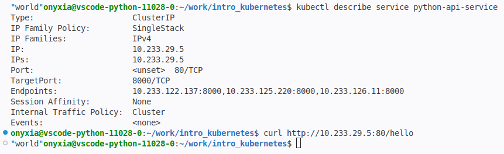
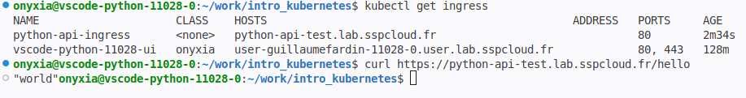

TP3

# Ma procédure

- En partie 1, je crée un service de type ClusterIP qui permet d'exposer l'application en local. Le deployment permet surtout de gérer les pods, pas de les exposer. Ci dessous, les deux commandes pour voir les infos du service et le tester :

- En partie 2, je crée un ingress qui permet d'exposer l'application sur internet. Il s'agit d'une sorte de routeur. Il pointe vers le service créé juste avant. Ci dessous, les deux commandes pour voir les ingress et tester celui créé:

- En partie 3, on reprend les 3 types de manifest déjà utilisés : deployment, service et ingress. L'objectif est de déployer une app 3-tiers, donc il faut faire chaque action pour le backend, le frontend et la base de données. L'ingress n'est nécessaire que pour le front. On ajoute des variables d'environment pour la base de données et le pour le backend (pour pouvoir contacter la bdd). Il faut que le nom du service backend soit backend et le port exposé 5000 parce que le front utilise ces valeurs dans le code. La bdd doit être sur 5432 et le nom doit correspondre entre les variables d'env 

# Mes difficultés

- Je pensais que le service devais pointer vers un deployment, alors qu'il recense des pods.

- J'ai eu un problème, j'avais mis le mauvais port pour le deployment du front.

# Mes remarques

- On peut regrouper tous les manifestes les uns à la suite des autres.

- Les ports peuvent êtres utilisés plusieurs fois à condition d'utiliser des noms différents.