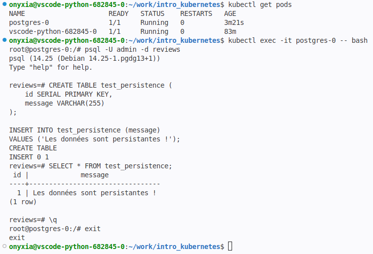

TP4

# Ma procédure

- dans la première partie du tp on crée un statefulset, qui permet d'assurer la persistance des données en cas de suppression de pod :
    - chaque pod est associé à un pvc (et donc les pods sont identifiés par ce volume et pas interchangeables)
    - quand on supprime un pod, il est recréé et les données écrites sont conservées :
        - pour vérifier on remplit la base de données :

        - puis on supprime un pod et on regarde s'il est recréé et s'il contient toujours les données

- la deuxième partie du tp porte sur le fait de rendre impossible l'écriture dans le conteneur du backend:
    - cela se fait avec securityContext: readOnlyRootFilesystem: true
    - lorsque qu'on applique le manifeste deployment, on obtient aucune erreur dans les logs, parce que notre application ne cherche pas à écrire quoi que ce soit (ce qui ne serait pas le cas avec une vrai app)
    - c'est une bonne pratique mais ça empêche l'écriture de fichiers temporaires comme les logs
    - pour résoudre ce dernier problème, on peut créer un emptydir, ce qui permet de monter un volume séparé du rootfilesystem et d'écrire dedans
     - le pod démarre bien
    - on peut donc écrire nos fichiers temporaires sans risquer la compromission de nos fichiers
    - la suppression du pod implique que l'emptydir est supprimé, contrairement à un PVC
    - en fait on se fiche que nos fichiers soient supprimés (fichiers temporaires)

# Mes difficultés

- le storageClassName: "standard" n'existe pas dans mon cluster et ça empêchait mon statefulset de tourner (en pending)
- après la modif, il fallait supprimer le pvc aussi avant de redémarrer le statefulset

# Mes remarques

- il faut prendre une application qui écris pour bien voir la deuxième partie