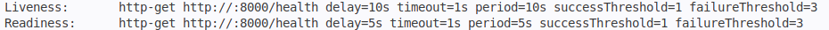
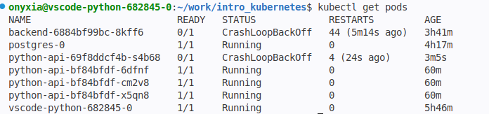

TP5

# Ma procédure

- on utilise les versions de hugosmn5/tp_python pour simuler des majs
- on ajoute les probes au manifeste créant un deployment pour l'app python, on apply et :
    - les pods sont running
    - on voit bien liveness et readiness en faisant un describe

- si la readiness echoue pour un pod, celui-ci n'est plus utilisé (pas de requêtes) jusqu'à ce qu'elle aie un succès à nouveau
- si la liveness echoue, elle redémarre le conteneur du pod
- la liveness a un délai de départ plus long parce qu'elle laisse le temps a l'app de démarrer (sinon elle risque de redémarrer alors que l'app n'a juste pas eu le temps de démarrer)

- on ajoute ensuite le rollingupdate qui met à jour les pods un par un quand on met à jour :
    - on peut changer la version du tag utilisé dans le deployment.yaml et apply
    - on voit que si on revient à la v1 ça ne marche pas, et le rollingupdate joue son rôle en ne tentant qu'une seule mise à jour infructueuse. L'application reste disponible grâce aux anciens pods :

# Mes difficultés

# Mes remarques

- je n'arrive pas à build des images depuis mon service vscode onyxia, je ne sais pas si c'est possible